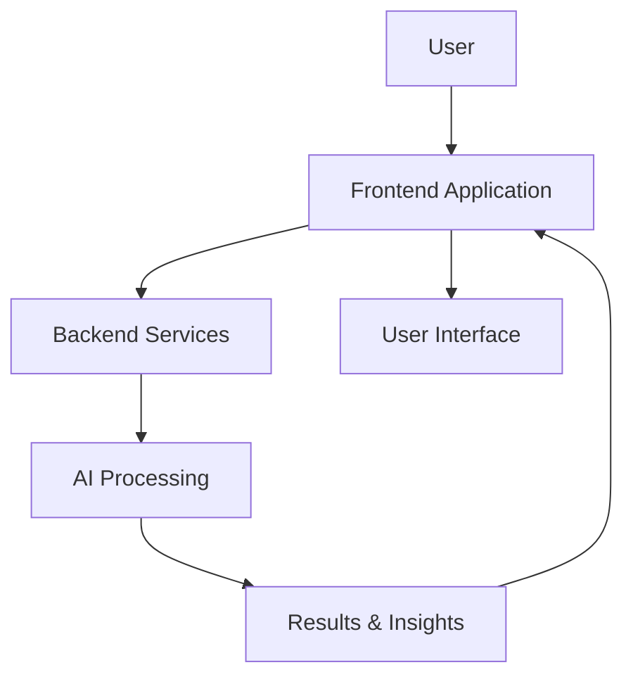

# 🌊 AquaNexus AI
### Intelligent AI-Powered Water Management System

<p align="center">
  <strong>Harnessing Artificial Intelligence for Smarter, Sustainable Water Management</strong>
</p>

<p align="center">
  
  
  
</p>

---

## 📌 Overview

**AquaNexus AI** is an AI-powered water management project designed to address water-related challenges through intelligent data processing, predictive insights, and technology-driven solutions.

The project aims to bring together artificial intelligence and modern web technologies to support smarter water management, improve decision-making, and encourage sustainable water resource utilization.

By combining an interactive frontend with a dedicated backend, AquaNexus AI provides a foundation for building intelligent and scalable water management solutions.

## 🎯 Problem Statement

Water resource management faces several challenges, including:

- Inefficient monitoring and management of water resources.
- Limited access to actionable water-related insights.
- Difficulty identifying potential issues through conventional approaches.
- The need for smarter, data-driven decision-making.
- Growing demand for sustainable water utilization.

Traditional approaches often lack the intelligence and automation needed to address these challenges effectively.

## 💡 Our Solution

AquaNexus AI explores the integration of Artificial Intelligence into water management workflows.

The platform is designed around an intelligent, technology-driven approach that connects frontend interactions with backend processing and AI capabilities.

Our goal is to make water management more accessible, efficient, and data-driven through a unified digital platform.

## ✨ Key Highlights

- 🤖 **AI Integration:** Incorporates artificial intelligence into water management workflows.
- 🌊 **Water Intelligence:** Focuses on intelligent approaches to water-related challenges.
- 💻 **Interactive Platform:** Provides a dedicated frontend experience.
- ⚙️ **Backend Processing:** Separates application logic into a backend architecture.
- 📊 **Data-Driven Approach:** Supports informed decision-making through technology.
- 🚀 **Scalable Architecture:** Organized frontend and backend components for future development.

## 🛠️ Technology Stack

The project is organized into two primary components:

| Component | Technology |
|---|---|
| Frontend | Refer to frontend implementation |
| Backend | Refer to backend implementation |
| AI/ML | Refer to backend implementation |

*The exact frameworks, models, and databases are determined by the project's implementation.*

## 🏗️ Project Architecture

```text
AquaNexus-AI/
│
├── frontend/
│   └── User Interface
│
├── backend/
│   └── Server & Application Logic
│
├── .gitignore
│
└── README.md
```

### System Workflow



*Conceptual architecture; adapt the workflow to the actual implementation.*

## 🚀 Getting Started

Follow these steps to set up the project locally.

### 1. Clone the Repository

```bash
git clone https://github.com/Yashwanthk06/AquaNexus-AI.git
```

### 2. Navigate to the Project

```bash
cd AquaNexus-AI
```

### 3. Set Up the Frontend

```bash
cd frontend
npm install
```

Start the frontend using the appropriate development command defined in `package.json`.

For example:

```bash
npm run dev
```

### 4. Set Up the Backend

Open another terminal:

```bash
cd backend
```

Install the dependencies using the package manager and instructions defined in the backend configuration.

Configure the required environment variables before starting the backend.

### 5. Run the Application

Start the frontend and backend services in their respective terminals using their configured startup commands.

> **Note:** Refer to the respective project configuration files for exact runtime requirements and environment variables.

## 🔐 Environment Configuration

If the application requires API keys or external service credentials:

1. Create the required `.env` file.
2. Add the necessary environment variables.
3. Never commit API keys, passwords, or private credentials to GitHub.

## 🏆 Achievement

<p align="center">
  <strong>🥇 FIRST PLACE — GREEN PULSE HACKATHON</strong>
</p>

AquaNexus AI secured **1st Place among 300 participating teams** at the Green Pulse Hackathon.

This achievement reflects our team's technical execution, problem-solving approach, collaboration, and commitment to building impactful technology-driven solutions.

## 🔮 Future Scope

Potential directions for further development include:

- Enhanced AI-driven water analysis and prediction.
- Real-time water monitoring integrations.
- Advanced analytics and visualization.
- Improved scalability and performance.
- Integration with additional water-related data sources.
- Intelligent alerts and recommendation systems.

## 👥 Team

Developed collaboratively as part of the Green Pulse Hackathon.

## 🤝 Contributing

Contributions, suggestions, and feedback are welcome.

1. Fork the repository.
2. Create a feature branch.
3. Commit your changes.
4. Push your branch.
5. Open a Pull Request.

## 📄 License

A license has not yet been specified for this repository. Please contact the project owners regarding usage and distribution permissions.

---

<p align="center">
  **Built with 💙 for a smarter and more sustainable water future.**
</p>

<p align="center">
  ⭐ If you find this project interesting, consider starring the repository!
</p>

<p align="center">
  <a href="https://github.com/Yashwanthk06/AquaNexus-AI">GitHub Repository</a>
</p>
